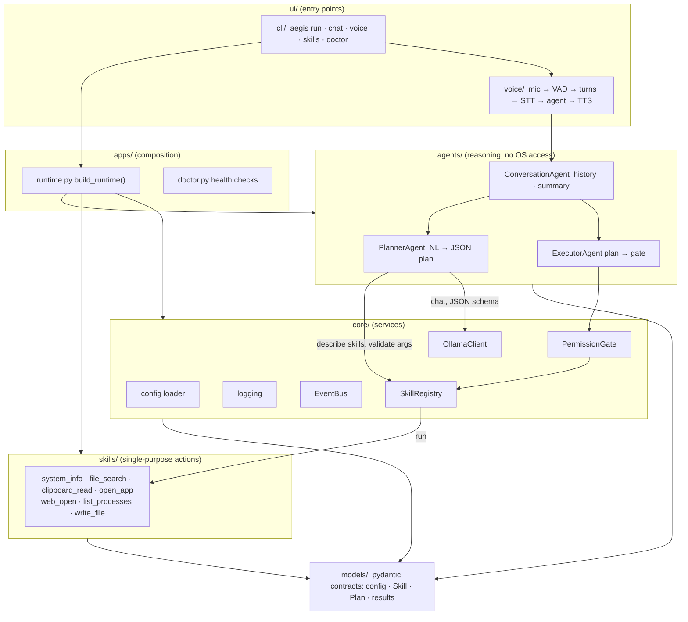
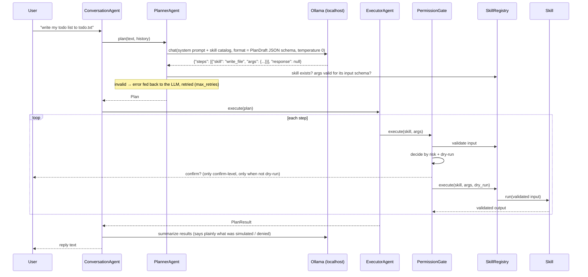
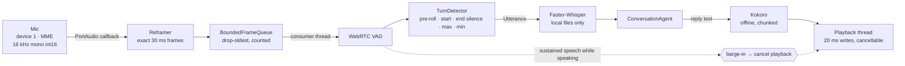

# AEGIS architecture

AEGIS turns natural-language requests (typed or spoken) into calls to small, typed
**skills**, and runs every call through a **permission gate**. Everything runs locally:
the LLM is Ollama on `127.0.0.1`, speech models load from the local disk, and nothing is
sent to the cloud.

## Layers

**Import rules** (checked by grepping `src/aegis`):

| Package | May import |
|---|---|
| `models` | nothing else in `aegis` |
| `core` | `models` |
| `skills` | `models`, and `core.registry` (only in `skills/__init__.py`, to register built-ins) |
| `agents` | `core`, `models`. Never `skills`: agents see skills only through the registry |
| `apps` | `agents`, `skills`, `core`, `models` |
| `ui` | `apps`, `core`, `models`, its own subpackages |

`apps/runtime.py` is the only place where config, registry, gate, LLM client and agents
are wired together.

## A request, end to end

A request that needs no skill ("what can you do?") gets a direct answer from the
planner's `response` field: one LLM call, nothing executed.

## Safety model

Every skill declares a **risk level**; the gate enforces it.

| Risk | Behaviour |
|---|---|
| `safe` | Runs without asking. Read-only, or launches only allow-listed apps / http(s) URLs. |
| `confirm` | Changes state. With `safety.dry_run: true` (the default) it only **simulates**. With dry-run off, the user must approve each call (`y/N`, default No). No prompt available, a declined prompt, or a crashing prompt all count as **denied**. |
| `blocked` | Never runs. The registry refuses it too, as a second line of defence. |

Further guarantees:

- `skills.yaml` overrides can only **raise** a skill's risk, never lower it.
- Skill inputs reject unknown fields, so an LLM can't invent arguments. Inputs are
  validated before any prompt is shown, and outputs are validated after the skill runs.
- `write_file` resolves paths and refuses anything outside `write_file.allowed_roots`,
  including `..` traversal, even after confirmation. It refuses to overwrite unless asked.
- `open_app` launches only aliases listed in `skills.yaml`; `web_open` only `http(s)`.
- The Ollama URL is validated to be a loopback address; no remote endpoint can be configured.
- The executor is deterministic: the LLM proposes a plan, but code (not the LLM) decides
  what runs, through the gate.

## Voice pipeline

- **Capture.** The audio callback does three cheap things: copy the buffer, cut it into
  exact frames, enqueue. The queue never blocks the callback; when full it drops the
  *oldest* frame and counts it. Device index and host API come from `voice.yaml` and are
  validated. A mismatch is an error with a fix-it message, never a silent switch to WASAPI.
- **Turn detection** is a pure state machine (easy to test): a ring buffer keeps
  `pre_roll_ms` of audio while idle; `start_frames` consecutive speech frames open a turn;
  `end_silence_ms` closes it (trailing silence trimmed); `max_utterance_seconds` cuts it;
  turns under `min_utterance_ms` are discarded. Memory is bounded in every state.
- **STT/TTS** load lazily and offline (`stt.local_files_only`, `tts.offline` →
  `HF_HUB_OFFLINE=1`). Models are fetched once, explicitly, by
  `scripts/fetch_voice_models.py`.
- **Playback** pulls audio chunks from Kokoro inside the playback thread, so speech starts
  after the first chunk, and cancelling also stops further synthesis.
- **Barge-in** (`barge_in.enabled`, off by default): while AEGIS speaks, `min_speech_ms` of
  continuous speech cancels playback (once per reply), and that speech becomes the next
  turn. There is no echo cancellation, so this needs headphones. With barge-in off (the
  default) the session is half-duplex: it waits for playback, then discards what the mic
  heard, so AEGIS can't hear and interrupt itself.
- **Offline.** `huggingface_hub` reads `HF_HUB_OFFLINE` only when first imported, so
  `ui/voice/offline.py` sets it (and the already-loaded constant) before Whisper or Kokoro load.

## Events

The `EventBus` is synchronous and thread-safe; a failing handler is logged and skipped.

| Topic | Published by | Payload |
|---|---|---|
| `permission.decided` | gate | skill, verdict, risk, dry_run, reason, confirmed |
| `skill.finished` | gate | skill, ok, error, dry_run |
| `plan.started` / `plan.step` / `plan.finished` | executor | goal, step index, ok, stopped reason |
| `voice.speech_started` / `voice.utterance` / `voice.discarded` | capture | durations only, never audio |

## Configuration

All behaviour comes from `configs/*.yaml`, validated by the pydantic models in
`src/aegis/models/config.py`. Unknown keys are rejected so typos fail loudly. Config dir:
`--config-dir` › `AEGIS_CONFIG_DIR` › `./configs`.

| File | Controls |
|---|---|
| `aegis.yaml` | logging, safety (`dry_run`, `require_confirmation`), agent limits |
| `models.yaml` | Ollama URL and timeouts, model per role, generation options |
| `skills.yaml` | enabled skills, risk overrides, per-skill settings (allow-lists, limits) |
| `voice.yaml` | audio device / host API / frames / queue, VAD + turn timing, STT, TTS, barge-in |

## Testing

- Unit tests (`tests/`, mirroring `src/aegis/`) need **no Ollama, microphone, speakers or
  models**: Ollama is faked with `httpx.MockTransport`, the LLM with a scripted `FakeLLM`,
  audio with a fake `sounddevice` module and scripted frames, STT/TTS/playback with fakes.
  OS calls in skills (`tasklist`, PowerShell, launchers) are injected and faked.
- Hardware and model checks are separate opt-in scripts:
  `scripts/check_ollama.py`, `scripts/diagnose_audio.py`, `scripts/check_voice_models.py`.
